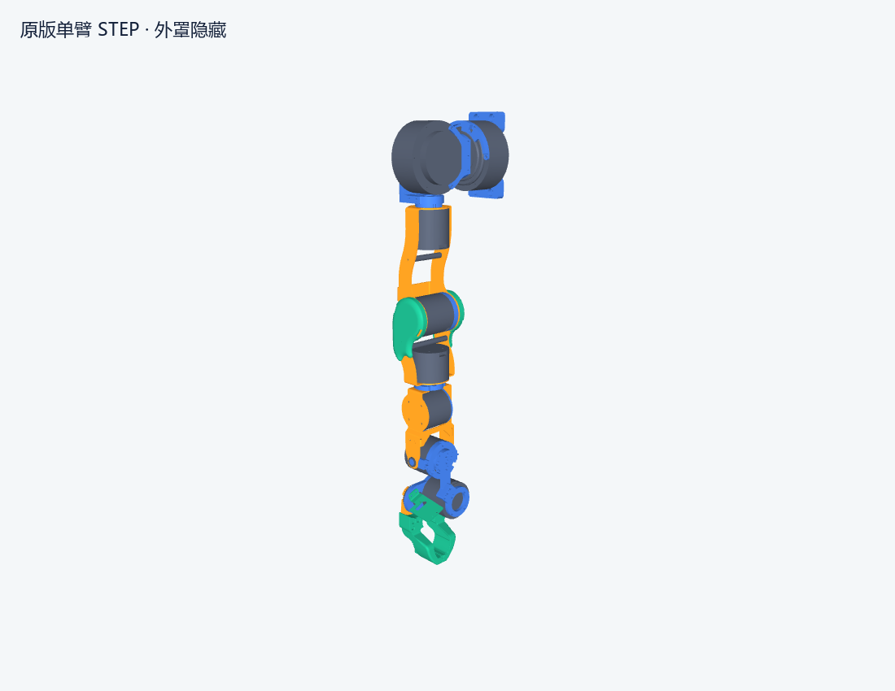
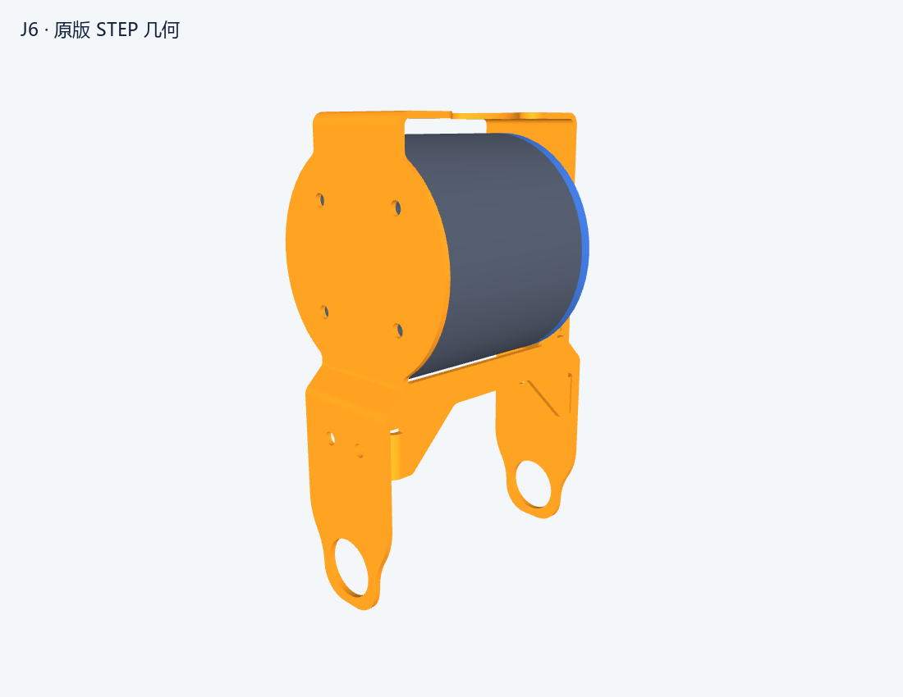
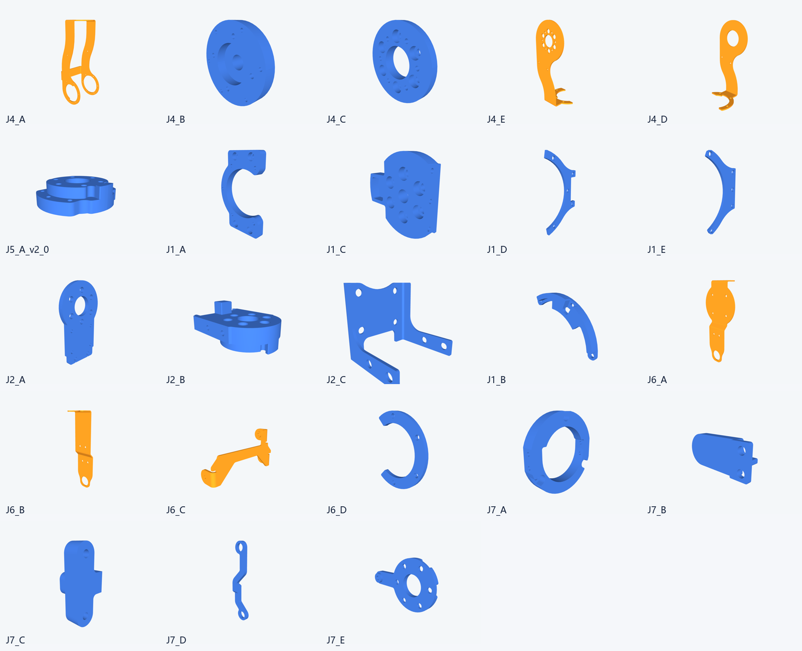

# OpenArm 轻载材料评估与 PLA／金属混合方案

更新：2026-11-20。用户接受 **PLA＋金属混合，优先降低完成固定双臂上半身的总成本**。本次按功能重新判断 34 组零件：外罩、理线、短相机架优先 PLA；夹指/指根作为受力试件；肩根、电机法兰、轴承座、轴以及首版承力薄板保留金属，先比较中国匹配结构包和分组加工。已购电机不换；下半身、轮组和移动电池继续暂缓。

这取代 2026-11-19“全部定制结构优先探索 PLA”的默认顺序，不表示所有金属件永远不能改塑料。J6 等长段仍可研究“金属端部＋PLA 闭合梁”，但目前没有带真实接口并通过验证的制造 CAD。先跑 VLA 的路线不再以完成整套 PLA 承力重设计为前提。

**“支架”只是名称，不能据此选材。** 相机支架主要托相机；肩根支架托整条臂并承受力矩。前者适合先试 PLA，后者首版保留金属。成本也不是按金属重量收费；几十种零件各自加工和检验，与已有同版套件/合批薄板不是同一种报价。

## 已执行的机械验证

2026-11-19 已运行 [PLA 部件有限元筛查](structural-screen/README.md)：原 CAD 的 J1_A、J4_A、J6_A/B/C，以及 J6 尺度的理想闭合箱形对照。原 J4/J6 薄板直接换 PLA 未通过刚度筛查；肩根孔边应力/真实连接待核。箱形截面有改善空间，但未含真实电机/轴承安装开口，不能据此打印装机。完整结果、边界条件、网格敏感性、材料脚注及复现代码见新报告。

## 阅读与交互视图

- 下文可直接在 GitHub 阅读，含全部 34 组零件的当前路线和原评估。
- [交互 HTML](openarm-material-review.html)含真实 STEP 三维选择、完整来源、材料比较和试验步骤。GitHub 文件页不执行 HTML；下载或克隆仓库后，从仓库根目录运行 `python -m http.server 8773`，再打开 `http://localhost:8773/design/material-review/openarm-material-review.html`。
- 三维使用固定版本 Three.js 0.160.1 CDN，需要联网；静态图和文字本地可读。没有发布 GitHub Pages 网站。
- [结构化矩阵](material-matrix.json)、[材料货号核对](material-source-match.json)、[CAD 索引](cad-part-index.json)、[静态计算](load-calculation.json)。



图像来自上游实体 STEP。蓝/黄/绿保留**初始保守评估分级**，用于辨认难点：蓝为原先建议保留的接口，黄为长段/混合候选，绿为优先打印件；颜色不表示原材料，也不表示当前必须采购金属。当前建议以各组文字为准；JSON 中 pla_first_path 保留上一版 PLA 构想作历史。图中仍是原几何，不是混合改版 CAD。




## 已核对的证据

34 个功能组覆盖 BOM 的 **38 条定制制造行**（7–31、50–60、78、90），另含标准件、外罩与新结构。抽取 73 个单侧/原支架 CAD 部件，网格包含父级装配变换。CAD 索引的包络、圆边和体积使用叶节点局部放置，不能当成整机世界坐标。

J1–J7 的 25 条货号中 24 条与官方 v1 制造表完整匹配，可追溯 Al6061/SUS304；J5_A_rotate90 不匹配。这不是独立 v2 材料证书。v2 夹爪不套用 v1 的材料结论。上游 BOM 也不是实际到货清单。[官方 v1 材料表](https://docs.openarm.dev/1.0/hardware/bill-of-materials/arm-manufactured/)、[v2 硬件](https://docs.openarm.dev/hardware/openarm-2.0/general/)。

原模型单臂质量约 6.130 kg（含基座和夹爪），运动部分约 4.987 kg。水平前伸时，假设物品中心在 EE 坐标 `[0,0,-0.100] m`，距肩方向约 0.536 m：

| 量 | 空手 | 每臂 0.5 kg 物品 | 每臂 1 kg 物品 |
|---|---:|---:|---:|
| 右 J1 静态重力补偿力矩绝对值 | 11.70 Nm | 14.33 Nm | 16.96 Nm |
| 双臂安装根部平面合成俯仰力矩绝对值 | 23.34 Nm | 28.60 Nm | 33.86 Nm |

这些是原模型的静态计算，包含原结构自重，不是打印改版的测量、动态载荷或承载等级。双臂根部平面的力矩也不是绕车轮边缘的倾覆力矩；轮式模型需重新平移合力、计算整机重心和支撑多边形。完整三姿态结果及 COM Jacobian 重力交叉检查见 JSON。

## 首版材料分工与省钱顺序

| 部位 | 首版建议 | 原因/进入条件 |
|---|---|---|
| J1_A/B/C、J2_B、J4_B/C、J5_A、J7_A/B/C/D/E | 金属 | 电机定位、轴承/销孔、预紧与紧凑载荷路径；未证明原样 PLA 够用 |
| J1_D/E、J2_A/C、J4_A/D/E、J6_A/B/C/D | 先询金属薄板合批价 | 薄板可能比另设计整套塑料连接更便宜；J4_A、J6_A/B/C 原样 PLA 已失败 |
| 夹爪基座、J7_joint、shaft_A/B | 首版金属接口与轴 | 齿轮中心距、轴配合和夹持反力；原材料仍需确认 |
| 夹指、finger_mount_adapter | PLA 试件＋必要金属套筒/紧固 | 需测夹持、堵转限力、热态和持载；适配件未通过时计回金属报价 |
| 外罩、理线夹、短相机支架 | PLA | 先查尺寸、温升、视野与线缆受力；装饰罩可延后 |
| 肩桥、短躯干、桌面固定 | 短标准金属框架＋PLA 外罩 | 不定制整个人形机身；选截面/连接前仍需验双臂根部载荷 |
| 轴承、螺栓、销、齿轮、薄垫片 | 按规格买现成件 | 标准件材质按功能，不一律金属，也不一律打印 |
| 下半身、升降/腰关节、移动电池 | 暂缓 | 固定双臂和模型实验不以这些部件为前提 |

36 条主臂/夹爪制造行、66 件原版参考中，夹指适配件（53/57，4 件）列为 PLA 受力候选，腕相机架（50/54，2 件）列为 PLA 附件；其余 **32 行、60 件**首版询金属价。这里的 60 件是结构原版参考询价数，不是已购买数量；若适配件试验未通过，需加回对应金属件。头/外部相机行 78/90 另外按需要打印。无 BOM 行的夹指、外罩、理线件亦在下方分组中。

**省钱的主因先找采购方式，不能保证少买几片金属一定省钱。** 比较同范围的“匹配双臂机械包”与“只买上述金属＋本地 PLA”；套件若更便宜且兼容就选套件，多余小件可作备件。中国加工、美国补缺、电气和到手价的比较见 [BUILD 采购安排](../../BUILD.md#procurement-budget)。没有宣称省下一个已确认的比例。

## 制作与验证次序

1. 核实际电机/轴承/螺栓接口，整理左右件和已有库存；打印被动配合试片及必要附件。
2. 按匹配套件/金属分组比较报价；短支承保持肩轴位置并核固定点载荷。首件检查孔位、配合、紧固和布线，再逐侧装配。
3. 如果金属长段仍贵或希望进一步减重，先研究 **真实金属端部＋J6_A/B/C PLA 闭合梁**。须完成接口 CAD、配合、弯扭和装配检查；既有理想箱梁不能直接制造。
4. 对实际采用的受力 PLA 做静态挠度、扭转、卸载残余、真实热点和持续漂移试验。1 h、24 h、72 h 持载及首轮 1,000 次循环只是筛查建议；40°C 是探索性暂停检查点，不是安全认证。
5. 根据实测确定负载/动作范围并更新质量、惯量、碰撞与重力补偿。逐侧联调后验双臂；刚体仿真不能证明 PLA 层间、热态或长期性能。结构稳定后再冻结学习/Fault Injection 基线。

PLA 需要重新分配截面，不能只提高填充率。材料牌号、层向、温度、接头与时间都影响结果；PLA Basic 的短时材料指标不能直接作为 PLA Matte 或整臂的长期设计值。[Bambu PLA Basic TDS](https://store.bblcdn.com/s7/default/3df0c03989c349d082e758e5d62c813b/Bambu_PLA_Basic_Technical_Data_Sheet_bf3411ce-be39-4db7-9669-1b4671d2196b.pdf)。

## 逐件路线

“初始评估”和 JSON 中 pla_first_path 保留此前判断/构想，用于追溯；当前路线以 2026-11-20 混合建议为准。本次没有新增 FEA 或实物试验；金属也需要装配验收，PLA 候选尚未完成实物验证。

### J1_A · 肩根安装件

**当前路线（首版金属接口/轴）：** 首版用金属肩根；优先中国同版现成包，缺件才单独 CNC。承担整臂弯矩且孔边/连接未验证，PLA 只做配合试片和不承力罩体。

- 材料依据：Al6061；v2 与 v1 完整货号相同（非 v2 材料证书）
- 载荷：整臂重量、前伸弯矩、双向扭转，经安装孔送入肩架。
- 难点：叉形开口削弱截面，孔边承压和长期预紧决定连接刚度；不是只受物品重量。
- 验证：实物孔距与孔型、配合面、紧固预紧力、最小净截面；肩根受力和温升。
- 双臂 BOM 行/总量：7：J1_A ×2

<details>
<summary>初始评估（历史，不是当前制造要求）</summary>

第一版保留金属。若改造，用标准短型材/板材承担力流，PLA 做定位与外形；禁止按原 12 mm 包络直接照抄打印。

</details>

### J1_B / J1_C · 肩部转接与夹持件

**当前路线（首版金属接口/轴）：** J1_B/C 首版用金属转接/夹持件，保持电机定位面。外部罩体可 PLA；不能把罩体可打印推成夹持座已可打印。

- 材料依据：Al6061；v2 与 v1 完整货号相同（非 v2 材料证书）
- 载荷：连接 J1/J2 区域，传递力矩与横向载荷；具体力流依据 CAD 装配推断。
- 难点：短紧凑件的孔位、夹持面及间隙比大体积减重更关键，贴近大电机。
- 验证：剖面/公差图、螺纹有效深度、转接刚度、重复拆装与热态松动。
- 双臂 BOM 行/总量：8：J1_B ×2；9：J1_C ×2

<details>
<summary>初始评估（历史，不是当前制造要求）</summary>

保留关键金属配合面和压块；外围非接触体积可打印，但需重新划分接口，不能仅加热熔螺母。

</details>

### J1_D / J1_E · 肩侧连接板

**当前路线（首版金属薄板）：** J1_D/E 首版保留 3 mm 金属侧板，与其他薄板合批切割/折弯询价。若改成 PLA 必须重画箱形结构并验证肩部空间，不直接照抄薄板。

- 材料依据：SUS304；v2 与 v1 完整货号相同（非 v2 材料证书）
- 载荷：两片有安装耳的 3 mm 板参与肩部连接，承担面内力、偏心弯曲和扭转。
- 难点：薄金属保留了大电机周边活动空间。左右耳根和螺栓孔对打印层间拉开敏感。
- 验证：孔边应力、耳根圆角、打印方向、扭转刚度、肩部扫掠间隙。
- 双臂 BOM 行/总量：10：J1_D ×2；11：J1_E ×2

<details>
<summary>初始评估（历史，不是当前制造要求）</summary>

第一版保留薄板；若取消整片板，应由金属耳座＋带闭合截面的打印件替代，不能只增加填充率。

</details>

### J2_A · 肩输出连接板

**当前路线（首版金属薄板）：** J2_A 首版保留 5 mm 金属输出板；询平板切割、孔加工和必要精加工，避免默认全件 CNC。孔圈、平面度及偏心弯曲仍需验收。

- 材料依据：SUS304；v2 与 v1 完整货号相同（非 v2 材料证书）
- 载荷：圆孔端连接输出接口，长端传力至下游，带偏心弯矩。
- 难点：原 CAD 是 5 mm 薄板；受力孔与窄长过渡集中，不适合原厚度 PLA。
- 验证：法兰孔/定位精度、板外弯曲、失速或急停受力、与 J2_B 的组合刚度。
- 双臂 BOM 行/总量：12：J2_A ×2

<details>
<summary>初始评估（历史，不是当前制造要求）</summary>

第一版保留金属，可评估平板切割/钻孔替代复杂加工；若打印必须改截面并保留金属法兰。

</details>

### J2_B · 上臂根部转接件

**当前路线（首版金属接口/轴）：** J2_B 首版用金属接口块，保留电机安装基准、螺纹和支承面；独立外罩用 PLA。

- 材料依据：Al6061；v2 与 v1 完整货号相同（非 v2 材料证书）
- 载荷：肩后级电机和连杆接口；承受上臂及以下部件的自重和力矩。
- 难点：紧凑的环形台阶、螺纹和局部耳座需要稳定配合，暖态漂移会累积到末端。
- 验证：接触面与轴线、安装螺纹、热态加载和拆装重复性。
- 双臂 BOM 行/总量：13：J2_B ×2

<details>
<summary>初始评估（历史，不是当前制造要求）</summary>

保留金属接口块；允许把不承力的罩体独立打印。

</details>

### J2_C · 上臂根部折弯连接件

**当前路线（首版金属薄板）：** J2_C 首版保留 1.5 mm 金属折弯件，合批加工。它参与根部连接/抗扭，不能因外形像盖子就改成装饰 PLA。

- 材料依据：SUS304；v2 与 v1 完整货号相同（非 v2 材料证书）
- 载荷：根部区域两侧连接与抗扭约束；须用装配图确认每个孔的实际力流。
- 难点：薄折弯形状靠截面深度工作；直接打印薄壁易在折角和螺栓处变形。
- 验证：装配约束、面外弯曲、夹紧力保持、层间开裂；不能凭它像罩子就删掉。
- 双臂 BOM 行/总量：14：J2_C ×2

<details>
<summary>初始评估（历史，不是当前制造要求）</summary>

保留首版；第二轮可与相邻打印壳合并为封闭承力段，保留端部压板/套筒。

</details>

### J4_A · 上臂长框架

**当前路线（首版金属薄板）：** J4_A 首版询原金属薄板价格；同外形 PLA 已未过刚度筛查。后续可研究金属端部＋PLA 闭合长梁，真实孔座、弯扭、温升及持载试验通过后才替换。

- 材料依据：SUS304；v2 与 v1 完整货号相同（非 v2 材料证书）
- 载荷：J3–J4 区域长框架，传递肘部以下重量、驱动力和扭转。
- 难点：长度约 182.5 mm（该件局部包络），薄钢边条与圆孔座能同时保持细长和刚度。
- 验证：肘轴同轴度、两端连接、弯曲/扭转挠度、最弱打印方向、热态 24–72 h 蠕变、活动空间。
- 双臂 BOM 行/总量：15：J4_A ×2

<details>
<summary>初始评估（历史，不是当前制造要求）</summary>

适合后续改成闭合箱形/双侧带筋 PLA 长段；圆孔端保留金属轴承座或夹片，穿透螺栓＋金属定长套筒。不能仅在原薄板上加厚。

</details>

### J4_B / J4_C · 肘部圆形接口

**当前路线（首版金属接口/轴）：** J4_B/C 首版保留金属电机/轴承接口。长段以后改 PLA 时仍优先复用这些端部；须确认连接方式和同轴度，不预设已能接上新梁。

- 材料依据：Al6061；v2 与 v1 完整货号相同（非 v2 材料证书）
- 载荷：圆形端部承担电机/轴承定位与法兰传力，B/C 分工需装配与公差图确认。
- 难点：短圆台阶和孔阵的精度敏感；打印配合松动会直接成为肘关节游隙。
- 验证：配合直径、轴向夹紧、孔位、温升后的同轴度和游隙。
- 双臂 BOM 行/总量：16：J4_B ×2；17：J4_C ×2

<details>
<summary>初始评估（历史，不是当前制造要求）</summary>

保留小型金属端部；长段可以换 PLA，不要求连整个框架都 CNC。

</details>

### J4_D / J4_E · 肘后两侧连接板

**当前路线（首版金属薄板）：** J4_D/E 首版保留 2 mm 金属肘侧板，与 J4_A 合批。可作为后续闭合 PLA 肘段候选，但现在没有真实接口和循环验证。

- 材料依据：SUS304；v2 与 v1 完整货号相同（非 v2 材料证书）
- 载荷：两侧板跨接肘后区域，包含被动孔座与主动孔阵；共同约束下游电机。
- 难点：薄板用较大两侧间距抗弯/抗扭，端部孔座不能靠层纹摩擦长期定位。
- 验证：双侧同轴、端部剥离、关节间隙、对线缆和关节范围的影响；低速循环与恒载。
- 双臂 BOM 行/总量：18：J4_D ×2；19：J4_E ×2

<details>
<summary>初始评估（历史，不是当前制造要求）</summary>

改为一体打印的中空连接体，保留两端金属小法兰/轴承座；保持原轴间距，先不缩臂。

</details>

### J5_A_rotate90 / CAD J5_A_v2_0

**当前路线（首版金属接口/轴）：** J5_A 首版按匹配电机的金属转接件询价；上游材料未确认，不能擅自填 6061 或 7075。先确认台阶、孔圈、材料与公差。

- 材料依据：v2 BOM 仅列 meviy 订货号；具体合金/材料未确认，不按代码猜测
- 载荷：短台阶转接件，连接肘后与腕前段。
- 难点：v2 货号与 v1 不同，无法确认沿用材质；CAD 有紧凑孔座和法兰结构，宜先保留原加工方案。
- 验证：新版订货图、公差、法兰传力、承压面与电机热接触。
- 双臂 BOM 行/总量：20：J5_A_rotate90.SLDPRT ×2

<details>
<summary>初始评估（历史，不是当前制造要求）</summary>

先核实新版图纸/材料；若降成本，优先标准金属座＋打印外围，不直接宣布它是 6061。

</details>

### J6_A / J6_B · 前臂两侧长板

**当前路线（首版金属薄板）：** J6_A/B 首版保留 1.5 mm 金属长板并询合批价；同外形 PLA 已未过筛查。若要增加承力塑料比例，先做带真实金属端部的闭合 PLA 梁台架，不直接打印原板。

- 材料依据：SUS304；v2 与 v1 完整货号相同（非 v2 材料证书）
- 载荷：把腕部、夹爪和物品重量传回前级，同时维持两侧支撑相对位置。
- 难点：A/B 功能不完全相同，但都是约 118.5 mm 跨度的薄板长段，值得作为同一组合替换。
- 验证：扭转刚度和末端漂移、孔座蠕变、J6 电机温升、层间强度和线缆间隙。
- 双臂 BOM 行/总量：21：J6_A ×2；22：J6_B ×2

<details>
<summary>初始评估（历史，不是当前制造要求）</summary>

优先结构试验件：PLA 闭合薄壁梁＋纵向筋，端部金属耳/套；保持外包络，新增筋朝空腔内长。

</details>

### J6_C_left / right · 前臂跨接件

**当前路线（首版金属薄板）：** J6_C 左右跨接件首版保留金属，与 A/B 成套报价；它是抗扭连接的一部分。后续与 PLA 梁一体重画时需验证连接和装配，左右件不互相替代。

- 材料依据：SUS304；v2 与 v1 完整货号相同（非 v2 材料证书）
- 载荷：跨接两侧板，保持间距并抵抗侧板张开；它不是装饰件。
- 难点：单独改薄 PLA 会降低整组抗扭，即使它本身重量很小。
- 验证：两侧间距变化、连接扭转、分层开口；左右件分别确认方向。
- 双臂 BOM 行/总量：23：J6_C_left ×1；24：J6_C_right ×1

<details>
<summary>初始评估（历史，不是当前制造要求）</summary>

与 J6_A/B 的打印闭合体整合，减少拼缝；保留穿透紧固和定长金属套筒。

</details>

### J6_D · 腕前环形限位/夹持件

**当前路线（首版金属薄板）：** J6_D 首版保留金属环形件；先确认夹持/限位实际作用与接触载荷，再决定能否将非接触区域改 PLA，不能当普通线夹打印。

- 材料依据：SUS304；v2 与 v1 完整货号相同（非 v2 材料证书）
- 载荷：环形开口件参与腕前约束；精确夹持/止挡分工仍需装配图。
- 难点：小而薄，减重收益有限，孔位与开口根部、潜在接触冲击更重要。
- 验证：作用面、是否承担硬限位、螺栓载荷与接触磨损。
- 双臂 BOM 行/总量：25：J6_D ×2

<details>
<summary>初始评估（历史，不是当前制造要求）</summary>

首版保留金属；确认仅作非受力罩支座之后才下调等级。

</details>

### J7_A · 腕部环形转接座

**当前路线（首版金属接口/轴）：** J7_A 首版保留金属腕部定位/转接座；紧凑孔圈与预紧保持优先于这部分少量材料节省。

- 材料依据：Al6061；v2 与 v1 完整货号相同（非 v2 材料证书）
- 载荷：环形电机接口、侧向支撑连接，传递末端力矩。
- 难点：圆周夹持与轴线稳定需要紧凑刚性；大幅加厚会直接让手腕变粗。
- 验证：环的配合、侧孔螺纹、热态游隙、工具碰撞的横向弯矩。
- 双臂 BOM 行/总量：26：J7_A ×2

<details>
<summary>初始评估（历史，不是当前制造要求）</summary>

保留金属薄环；外罩和线缆支架打印。

</details>

### J7_B / J7_C · 腕部耳座与桥接块

**当前路线（首版金属接口/轴）：** J7_B/C 首版保留金属轴承耳座与桥接块，检查销孔/轴承同轴度；外侧可加可拆 PLA 罩。

- 材料依据：Al6061；v2 与 v1 完整货号相同（非 v2 材料证书）
- 载荷：J7_B 每臂两件，含凸轴/孔座；J7_C 连接支撑，维持腕部轴线。
- 难点：集中承压与尺寸稳定比材料用量更关键；螺栓套筒不能自动替代一段精密轴。
- 验证：轴承配合、公差链、端面间隙、循环磨损。
- 双臂 BOM 行/总量：27：J7_B ×4；28：J7_C ×2

<details>
<summary>初始评估（历史，不是当前制造要求）</summary>

保留轴/孔所在的小金属块。可把跨接外围改 PLA，但先不把短精密件当优先省钱目标。

</details>

### J7_D_left/right / J7_E · 腕末连接

**当前路线（首版金属接口/轴）：** J7_D 左右件及 J7_E 首版保留金属窄法兰；按实际台阶、孔和螺纹选工艺，不因片状外形就认定可直接激光切割。

- 材料依据：SUS304；v2 与 v1 完整货号相同（非 v2 材料证书）
- 载荷：细窄跨接件与圆形法兰传递末端弯扭载荷，保持腕末位置。
- 难点：细颈、偏心臂和孔座的局部载荷明显；纯 PLA 等包络刚度低。
- 验证：偏心弯矩、窄颈应力、工具撞击、重复定位和夹紧漂移。
- 双臂 BOM 行/总量：29：J7_D_left ×1；30：J7_D_right ×1；31：J7_E ×2

<details>
<summary>初始评估（历史，不是当前制造要求）</summary>

保留金属关键路径；若合并重设计，要把跨接做成闭合截面并留金属轴/法兰。

</details>

### 夹爪 base_4310

**当前路线（首版金属接口/轴）：** 夹爪 base_4310 首版询匹配的金属基座，保持电机和齿轮中心距；原材料待核。后续 PLA 加筋基座需要独立夹持/热态验证。

- 材料依据：v2 BOM 仅列 meviy 订货号；具体合金/材料未确认，不按代码猜测
- 载荷：承载夹爪电机与传动部件，维持齿轮/轴的相对位置。
- 难点：自重小不代表夹持反力小；夹持挤压力和卡住时的力矩也作用在基座。
- 验证：v2 材料、齿轮中心距、夹持电流上限、热态平行度。
- 双臂 BOM 行/总量：60：end-efector_base_4310.SLDPRT ×2

<details>
<summary>初始评估（历史，不是当前制造要求）</summary>

首版保留原加工基座；第二轮可评估金属轴座＋PLA 箱体组合。

</details>

### 夹爪 J7_joint_A/B/C_4310

**当前路线（首版金属接口/轴）：** J7_joint_A/B/C 首版用匹配金属关节连接件；材料待核，核对左右数量、孔距与夹爪平行度。外罩不必随之金属化。

- 材料依据：v2 BOM 仅列 meviy 订货号；具体合金/材料未确认，不按代码猜测
- 载荷：工具与腕部连接、传动/支承接口；同属一组接口，但各件分工需公差图确认。
- 难点：小零件上集中孔、台阶与载荷，打印节省的体积很少，间隙会影响精细抓取。
- 验证：新版材质与公差、工具偏心、手眼标定重复性、持载与循环。
- 双臂 BOM 行/总量：51：copy_end-efector_J7_joint_A_4310_mir.SLDPRT ×1；52：copy_end-efector_J7_joint_B_4310.SLDPRT ×2；55：copy_end-efector_J7_joint_A_4310.SLDPRT ×1；58：copy_end-efector_J7_joint_C_4310.SLDPRT ×2

<details>
<summary>初始评估（历史，不是当前制造要求）</summary>

保留金属接口，夹爪外壳另打印；不可用 v1 滑轨夹爪材料表给这些 v2 件定材。

</details>

### 夹爪 shaft_A / shaft_B_4310

**当前路线（首版金属接口/轴）：** 夹爪 shaft_A/B 用金属轴。先比现成标准轴能否满足台阶、长度和锁紧方式；不能匹配时随结构包车削，不能把打印轴当等价替代。

- 材料依据：v2 BOM 仅列 meviy 订货号；具体合金/材料未确认，不按代码猜测
- 载荷：转轴/轮毂，承担传动扭矩、轴承配合和轴向定位。
- 难点：耐磨、孔轴配合与夹紧是首要约束；普通 PLA 原尺寸转轴不是合理首版。
- 验证：轴径与公差、止转结构、接触应力、磨损；实际材料仍未确认。
- 双臂 BOM 行/总量：56：copy_end-efector_shaft_B_4310.SLDPRT ×2；59：end-efector_shaft_A_4310.SLDPRT ×2

<details>
<summary>初始评估（历史，不是当前制造要求）</summary>

保留金属转轴/轮毂；可研究标准轴＋夹紧式轮毂替代定制件，必须匹配接口。

</details>

### finger_mount_adapter_A/B_4310

**当前路线（PLA 受力试件，待验证）：** finger_mount_adapter_A/B 可作为 PLA 指根试件，使用穿透螺栓与金属套筒分担孔压。先验证实际夹持力、堵转限力、热态与持续变形；未通过则保留匹配金属件。

- 材料依据：v2 BOM 仅列 meviy 订货号；具体合金/材料未确认，不按代码猜测
- 载荷：把驱动力传到夹指，承受夹持力与指尖偏心弯矩。
- 难点：负载由夹持控制决定；拿一件轻衣服时也可能因大电流或卡料受很大力。
- 验证：指尖力标定、根部断裂、夹持保持、循环后回差、视觉遮挡。
- 双臂 BOM 行/总量：53：copy_end-efector_finger_mount_adapter_A_4310.SLDPRT ×2；57：copy_end-efector_finger_mount_adapter_B_4310.SLDPRT ×2

<details>
<summary>初始评估（历史，不是当前制造要求）</summary>

可先做 PLA 加筋指根，驱动孔/轴孔保留金属衬套和压板；须同时限制夹持力。

</details>

### finger_L / finger_R_v5_4310

**当前路线（PLA 受力试件，待验证）：** 夹指本体优先 PLA，接触面粘贴现成橡胶/硅胶/泡棉垫，不为软垫购买 AMS。先验证夹持载荷、指根和磨损，不照搬未验证的更长夹指。

- 材料依据：CAD 可见；原材料未在该 BOM 中说明，不能宣称原版已验证 PLA
- 载荷：直接接触衣物/小物品，传递夹持力和抓取偏心。
- 难点：没有证据说明必须整件金属；但长指尖仍受弯曲，硬 PLA 表面不等于柔软抓取。
- 验证：CAD 有这些件，抽取 BOM 未列具体材料/打印参数；需检查夹持力、疲劳、指尖挠度和布料挂钩。
- 双臂 BOM 行/总量：本次 BOM 未单列；见 CAD 或新设计范围

<details>
<summary>初始评估（历史，不是当前制造要求）</summary>

优先 PLA 指体＋可更换橡胶/硅胶/泡棉接触垫；短粗指根、圆角、穿透螺栓，避开视觉区域。

</details>

### camera_mount_4310 左右

**当前路线（PLA 附件）：** 左右腕相机架优先短、带筋的 PLA 件，穿透紧固并为线缆卸力；检查相机温升、视野与姿态漂移。只为实际使用的相机制作。

- 材料依据：v2 BOM 仅列 meviy 订货号；具体合金/材料未确认，不按代码猜测
- 载荷：腕部相机自重、线缆拉力和振动，不承担主臂传力。
- 难点：金属有利于薄和稳定，但轻载相机支架通常无需与关节强度同级。
- 验证：相机姿态漂移、手眼标定、热态长时间运行、视野遮挡和震动。
- 双臂 BOM 行/总量：50：copy_camera_mount_4310_mir.SLDPRT ×1；54：copy_camera_mount_4310.SLDPRT ×1

<details>
<summary>初始评估（历史，不是当前制造要求）</summary>

优先短而带三角筋的 PLA 支架＋螺钉/螺母和线缆卸力；留电机散热间隙。

</details>

### 手臂与夹爪外罩

**当前路线（PLA 附件）：** 手臂/夹爪外罩用 PLA，可先不装装饰罩；保留散热、运动间隙和维护入口，不让罩子承担主结构载荷。

- 材料依据：CAD 独立罩件；本次 BOM 未列材质，不视作整臂 PLA 许可
- 载荷：保护、导线隔离与轻微触碰；不要承接主关节载荷。
- 难点：未发现必须用金属的受力理由；外罩与内部长板在 CAD 中是独立件。
- 验证：原材未确认；检查全角度碰撞、内部温度、夹点、拆装与挂线。
- 双臂 BOM 行/总量：本次 BOM 未单列；见 CAD 或新设计范围

<details>
<summary>初始评估（历史，不是当前制造要求）</summary>

普通 PLA 分件打印可作为首版；螺钉可拆、圆角、适度通风；别紧贴电机或夹住转动部件。

</details>

### cable_holder_J4_A/B

**当前路线（PLA 附件）：** 理线夹用 PLA，远离热点并保留弯曲与拉力余量；按实测布线分段制作，不能用夹子拉紧连接器。

- 材料依据：CAD 有件；材料未说明
- 载荷：线缆自身重量、弯曲回弹和拉扯。
- 难点：没有必要按主承力件选材；最先影响的是线缆寿命与拉力卸载。
- 验证：弯曲半径、关节全范围拉线、接插件卸力、热源附近温度。
- 双臂 BOM 行/总量：本次 BOM 未单列；见 CAD 或新设计范围

<details>
<summary>初始评估（历史，不是当前制造要求）</summary>

PLA 线夹＋软内衬，圆滑走线，预留活动余量。

</details>

### 螺栓、轴承、销、支柱

**当前路线（现成功能件）：** 轴承、螺栓、销和承力支柱用现成金属标准件；优先随匹配机械包采购，按实物库存扣减。PLA 定位套不能自动代替承压定长套筒。

- 材料依据：标准采购件，具体钢种/表面处理以供应商规格为准；金属功能件建议保留
- 载荷：紧固预紧、转动支撑、剪切、定位和防止夹紧压溃。
- 难点：这些金属小件保留后能明显扩大 PLA 的可用范围；不能把“尽量打印”等同于打印轴承与螺栓。
- 验证：订货/实物规格、支柱 BOM AETTS 与 CAD SETS 命名不一致，需核对；螺栓长度、底孔啮合和预紧。
- 双臂 BOM 行/总量：32：M3x6 bolt ×146；33：M3x8 bolt ×38；34：M3x15 bolt ×24；35：M3x18 bolt ×12；36：M4x6 bolt ×16；37：M4x8 bolt ×16；38：M4x10 bolt ×24；39：M5x10 bolt ×24；40：Circular Post - Threaded on Both Ends ×2；41：Circular Post - Threaded on Both Ends ×4；42：Step Bolt ×4；43：Single-row deep groove ball bearing ×4；44：Ball bearing, flanged, double shielded ×4；45：Ball bearing, flanged, double shielded ×2；61：M3x6 bolt ×14；62：M3x8 bolt ×56；63：M3x10 bolt ×12；64：M3x20 bolt ×12；65：Ultra Low Profile Socket Head Cap Screw ×12；66：M2x4 bolt ×8；68：Ball bearing ×2；69：General-Purpose Pin g6 ×2；70：General-Purpose Pin g6 ×2；77：M2x5 bolt ×2；89：M3x6 bolt for cameramount ×2

<details>
<summary>初始评估（历史，不是当前制造要求）</summary>

保留标准件；穿透螺栓配定长金属套筒、压板和防转键。套筒端面对接金属面；靠大垫片仍不能消除 PLA 蠕变。

</details>

### 夹爪齿轮 SL-GEAHS1.0…

**当前路线（现成功能件）：** 夹爪齿轮先买原规格功能件，核模数、齿数、孔径和锁紧；材料依供应商资料，不默认 PLA 齿轮或假定所有齿轮都是金属。

- 材料依据：BOM 给出成品齿轮型号，未在本次资料中确认具体合金
- 载荷：传递夹持扭矩、同步两指。
- 难点：齿面磨损、齿根疲劳和回差影响抓取重复性，轻物品不能限定堵转力矩。
- 验证：供应商材料、啮合间隙、润滑/磨屑与夹持循环。
- 双臂 BOM 行/总量：67：Cleaned Spur Gear, Module 1.0, Machined Bore Type ×4

<details>
<summary>初始评估（历史，不是当前制造要求）</summary>

首版保留原采购齿轮；打印齿轮另做消耗性试验，不和结构改版同时引入。

</details>

### SWSPS12-6-0.5 薄树脂垫片

**当前路线（现成功能件）：** 薄树脂垫片按原厚度与规格采购；这是树脂标准件，不是必须金属的零件，也不值得用 FDM 追求 0.5 mm 精密垫片。

- 材料依据：BOM 明确称 Ultra-thin resin washer
- 载荷：隔离、间隙/摩擦调整。
- 难点：它本来就是树脂，不应误计为必须保留的金属件。
- 验证：具体材料、厚度公差和磨损。
- 双臂 BOM 行/总量：46：Ultra-thin resin washer ×8

<details>
<summary>初始评估（历史，不是当前制造要求）</summary>

优先保留采购垫片；0.5 mm 功能垫片不以普通 PLA 薄片直接替代。

</details>

### 原版立柱、底板与型材角件

**当前路线（短标准金属支承＋PLA 外罩）：** 原版长立柱/整套底座仅作参考；首版用短的现成金属型材/角件可靠固定到已有工作台。长而重的型材优先美国本地切长，截面和固定点由载荷确认。

- 材料依据：立柱：官方明确铝型材；底板和角件具体合金未确认
- 载荷：两条手臂的重量、合力矩和工作台固定反力。
- 难点：官方明确立柱为 MISUMI 铝型材；本地 CAD 是 60×60×750 mm 型材及固定台面底座，不是轮式底盘。
- 验证：型材截面与接头刚度、脚轮支撑多边形、载荷重心；底板合金未确认。
- 双臂 BOM 行/总量：本次 BOM 未单列；见 CAD 或新设计范围

<details>
<summary>初始评估（历史，不是当前制造要求）</summary>

原版仅作为受力路径参考。轮式版可改高度与形状，但无需复制 750 mm 立柱或厚底板。

</details>

### 新双肩连接与肩桥

**当前路线（短标准金属支承＋PLA 外罩）：** 肩桥用短金属型材或矩形管＋必要端板，PLA 做外罩和非承力定位附件；保持基准肩轴位置，不额外外移 85 mm/侧。连接/截面设计尚未冻结。

- 材料依据：尚未设计，无所谓“原版材质”；本行是新方案建议
- 载荷：接收两臂同时前伸的俯仰合力矩，以及单臂伸侧造成的扭转。
- 难点：这里主导的是整臂自重和两侧连接刚度；纯 PLA 要做到同样细窄很困难，但并非已证明不可行。
- 验证：新件尚无定稿 CAD。先核孔位、力流、梁截面、螺栓组、弯扭挠度；保留模型原坐标基线。
- 双臂 BOM 行/总量：本次 BOM 未单列；见 CAD 或新设计范围

<details>
<summary>初始评估（历史，不是当前制造要求）</summary>

候选：左右小金属接口板＋一根窄金属横梁/短型材＋PLA 外形。紧固力经套筒/金属面闭合；避免额外外移肩轴。

</details>

### 新躯干立柱/脊柱

**当前路线（短标准金属支承＋PLA 外罩）：** 只做固定所需短金属支承，外面可套 PLA 机身壳；暂不做高躯干、升降或腰关节。先核双臂前伸弯矩、工作台与连接刚度。

- 材料依据：新设计；尺寸和金属截面尚未选定
- 载荷：把肩桥力矩传到车架，承受整机弯扭及行走振动。
- 难点：多段 PLA 加长螺杆只解决部分夹紧问题，不能自动提供稳定的抗弯/抗扭；预紧仍可能因塑料压缩而松弛。
- 验证：目标高度、质量重心、截面惯性矩、节点松动、热态长时漂移与制动载荷。
- 双臂 BOM 行/总量：本次 BOM 未单列；见 CAD 或新设计范围

<details>
<summary>初始评估（历史，不是当前制造要求）</summary>

候选：一根金属矩形管或短型材主脊柱，上下小接板；PLA 打印线槽、电子仓和曲面外壳。全 PLA 分段躯干留作独立比较试样。

</details>

### 新轮式底盘、轮轴与电池支承

**当前路线（本阶段暂缓）：** 下半身、轮组、轮架、移动电池本阶段不制作或采购；固定台架结果不能证明未来移动稳定性。

- 材料依据：新设计；轮组/底盘电机和整机质量未选定
- 载荷：轮轴冲击、制动反力、两臂前伸倾覆力矩、整机重量。
- 难点：原版台面锚固不能转用为移动底盘稳定性证据。轮径、轮距、质量和重心未知，不能给出已安全的窄底盘尺寸。
- 验证：支撑点而非外壳轮廓、前后/左右防倾覆、刹车、越缝冲击、单轮卸载；电池托盘承重需单测。
- 双臂 BOM 行/总量：本次 BOM 未单列；见 CAD 或新设计范围

<details>
<summary>初始评估（历史，不是当前制造要求）</summary>

候选：小金属车架/横梁＋金属电机轮轴支座；PLA 外裙、轻载托盘。电池低置并固定；不预设一整块厚钢板压重。

</details>

### 头相机架与固定头部

**当前路线（PLA 附件）：** 有实际需要才打印短带筋 PLA 头/场景相机架，先复用 D405；不为造型购买 ZED、头部电机或完整头壳，视野与模型输入另验。

- 材料依据：v2 BOM 仅列 meviy 订货号；具体合金/材料未确认，不按代码猜测
- 载荷：相机与头罩自重、线缆力和车体振动。
- 难点：固定轻头不需要复制臂部的金属等级；但头晃会污染视觉。
- 验证：相机实际重量、热源、视野、姿态重复性；原相机支架材料待确认。
- 双臂 BOM 行/总量：78：cameramount_head_zed.SLDPRT ×2

<details>
<summary>初始评估（历史，不是当前制造要求）</summary>

短支座、三角筋和穿透紧固的 PLA 候选。若以后加云台电机，要另评轴/轴承座；当前不加购。

</details>

### 新外罩、柔软外观与装饰

**当前路线（PLA 附件）：** 机身外罩优先 PLA；首轮可只做必要护盖，把装饰整壳延后，保留接头、电源散热与停止装置可达性。

- 材料依据：新设计；装饰层和承力层分别选材
- 载荷：自重、轻触、拆装；与骨架分工。
- 难点：PLA 可塑造外形但仍是硬塑料，不提供柔软皮肤。
- 验证：散热、关节夹点、布料卷入、清洁与拆装；外罩不得顺带成为主骨架。
- 双臂 BOM 行/总量：本次 BOM 未单列；见 CAD 或新设计范围

<details>
<summary>初始评估（历史，不是当前制造要求）</summary>

PLA 薄壳＋可拆布料/泡棉或局部软垫，露出散热/检修区；不为“像人”扩大肩架。P1S 单色即可，不依赖 AMS。

</details>

### 外部/天花相机安装架

**当前路线（PLA 附件）：** 需要外部视角时用短带筋 PLA 架；长悬臂另作支承，检查长期姿态与线缆卸力，不默认采购原版天花相机组件。

- 材料依据：v2 BOM 仅列 meviy 订货号；具体合金/材料未确认，不按代码猜测
- 载荷：独立场景相机自重和线缆拉力，与机器人承力链无关。
- 难点：无需跟随主臂一律用金属；长期姿态稳定仍重要。
- 验证：相机位置、固定基面、姿态漂移及线缆卸力。
- 双臂 BOM 行/总量：90：cameramount_ceiling.SLDPRT ×1

<details>
<summary>初始评估（历史，不是当前制造要求）</summary>

若沿用此相机方案，可做短带筋 PLA 架＋穿透螺母；不是轮式机器人必须购买的部件。

</details>

## 复算入口与来源

从 [OpenArm Hardware 2.0.0 发布包](https://github.com/enactic/openarm_hardware/releases/tag/2.0.0)取得 STEP/BOM；从 [锁定 MuJoCo 提交](https://github.com/enactic/openarm_mujoco/tree/a3c8a57ec15d385e3c1dbd3fd090ee486b7f258c)取得完整模型和 assets。来源提交与原有记录见 [upstreams.lock.json](../../upstreams.lock.json)。JSON 保存本次实际输入文件的 SHA-256；若输入哈希不同，应视为新的计算版本，不直接覆盖成同一证据。

以下从仓库根目录运行，路径替换为下载后的真实位置。建议使用独立 Python 环境；MuJoCo 计算使用 3.16.0，CAD 使用 build123d/OCP（精确运行版本见 [验证记录](review-checks.json)）。

```shell
python design/material-review/reproduce-load-calculation.py --model /path/to/openarm_mujoco/v2/openarm_bimanual.xml --output-dir work/material-loads
python design/material-review/reproduce-cad-extraction.py --step "/path/to/OpenArm 2.0/OpenArm_2.0.STEP" --output-dir work/material-cad
```

前者需要 `mujoco` 与 `numpy`；后者需要 `build123d` 与 `numpy`。CAD 入口生成索引和网格，不生成新的 PLA 设计或切片。网页和 PNG 是本次已生成的评估快照；入口复算范围仅为载荷与 CAD 数据，不声称自动重建整个网页。

## 许可与修改范围

CAD 渲染、嵌入网格、几何索引及 BOM 摘录来自 Enactic OpenArm Hardware 2.0.0（提交 `eefc9fa5509562e5e4d630db9a52027afdbc6af1`），保留其 [CERN-OHL-S-2.0 许可全文](LICENSE-CERN-OHL-S-2.0.txt)。完整原始设计来源为上方发布包。本次派生修改是选取单侧组件、坐标变换、网格化、渲染、颜色分级和评估标注；没有发布修改后的制造 CAD。上游署名归 Enactic/OpenArm contributors，Cadenza 不主张原机构为原创。

MuJoCo 来源保留 Apache-2.0 标记，本目录引用来源和计算结果，没有复制上游模型或软件。Three.js 0.160.1 按 MIT 许可通过 CDN 加载，未在仓库复制其库代码。[Three.js 许可](https://github.com/mrdoob/three.js/blob/r160/LICENSE)。

已完成：材料追溯、CAD 提取/可视化、静态计算与文档检查；另已完成 [指定部件的线弹性 FEA 筛查](structural-screen/README.md)。未完成：带真实接口的新承力件制造 CAD、全上半身结构/接触/热态/长期验证、实物强度/温升/蠕变/疲劳、闭环运动控制及轮式稳定性验证。历史交互 HTML 仍是首版材料评估快照；最新机械状态以新增报告为准。发布评估不等于发布可生产的全 PLA OpenArm。
