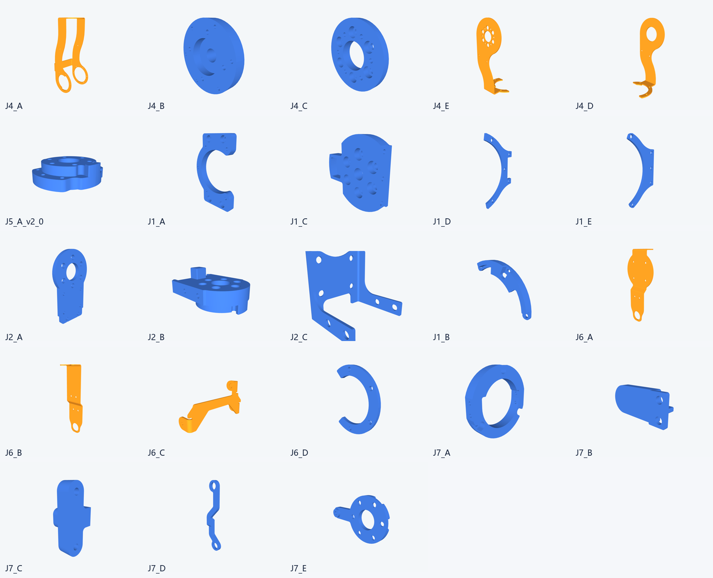
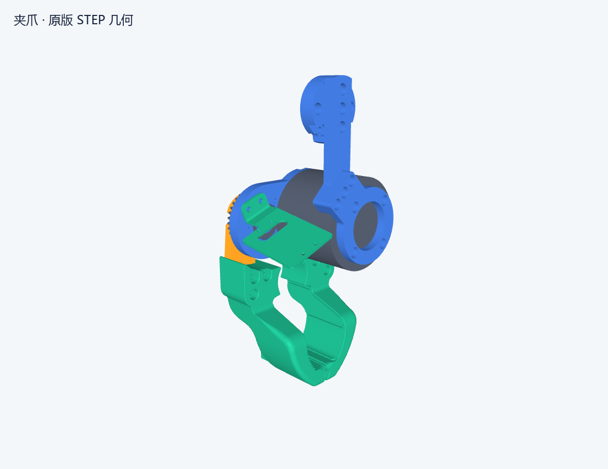
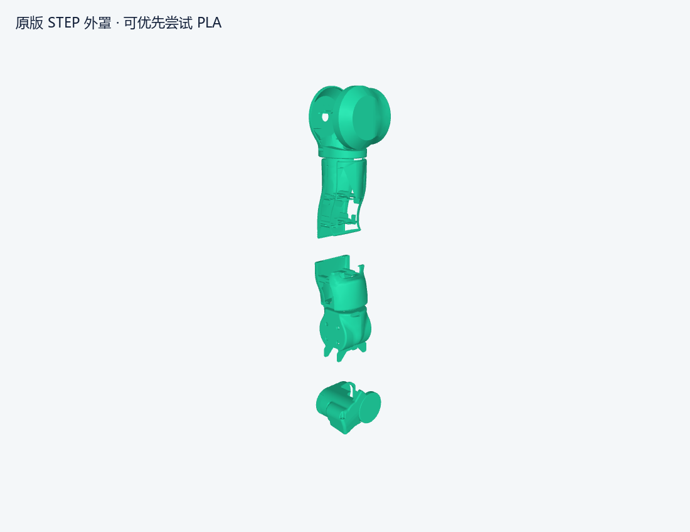

# 这里有哪些 CAD，怎样在 Fusion 打开

核对日期：2026-11-20。这里区分完整官方源文件、仓库中已有的单件 STEP、以及预览图片。没有把预览图或仿真网格当作打印文件，也没有声称已经在 Fusion 逐件导入验收。

## 官方完整源文件

从 [OpenArm hardware 2.0.0 release](https://github.com/enactic/openarm_hardware/releases/tag/2.0.0) 的 `openarm-hardware-2.0.0.tar.gz` 下载解压。完整包保留在本机；本仓库不复制整个上游发布包。

其中 `OpenArm 2.0/` 目录实际有以下 4 个文件：

| 文件 | 类型/大小 | 内容 |
|---|---|---|
| `OpenArm_2.0.STEP` | STEP，47,788,783 bytes | 主整机装配，零件位于装配层级中 |
| `Options/OpenArm_2.0_w_Head_Camera.STEP` | STEP，50,200,547 bytes | 带头部相机的装配版本 |
| `OpenArm 2.0 BOM.xlsx` | 物料表 | 零件货号、数量和来源，不是打印任务 |
| `README.docx` | 说明文档 | 不是 CAD |

**上述主臂目录没有独立 STL、3MF 或原生 SLDPRT/SLDASM。** BOM 里带 `.SLDPRT` 的零件名不表示下载包附带同名 SolidWorks 文件。STEP 可以继续拆件/导出打印网格，但能导出不等于该金属外形已经适合塑料打印。OpenArm Mini 的打印件属于另一套示教器，不和这个主臂包混用。

本次重新核对本机归档 SHA256：`247ce0141a9be6ebbb5a6c206cf0557574929ea0b80e20dddbff7c0c0919db75`，与 release 元数据相同。主 STEP SHA256：`0f97a5fb308d5b09353aa67bbd32d7c08e55dc5629bcbe20c12f71c82ef13c94`，与此前分析相同。

## GitHub 已有的独立 STEP

为复现结构筛查，只抽出下列 5 个原形状文件；J6 三个文件在求解时理想粘合为一个组合。它们没有改厚、加筋或换成箱梁。

| 文件 | 对应形状 |
|---|---|
| [J1_A.step](../structural-screen/geometry/J1_A.step) | 肩根 C 形安装座 |
| [J4_A.step](../structural-screen/geometry/J4_A.step) | 上臂/肘部薄框架，两端安装区域 |
| [J6_A.step](../structural-screen/geometry/J6_A.step) | 前臂一侧薄连接板 |
| [J6_B.step](../structural-screen/geometry/J6_B.step) | 前臂另一侧薄连接板 |
| [J6_C.step](../structural-screen/geometry/J6_C.step) | 两侧板之间的跨接件 |

其余主臂/夹爪形状可以从完整 STEP 装配查看；本仓库尚没有逐个导出的完整双臂制造包。

## 每个零件长什么样

上图是主臂主要结构形状的独立预览，每格单独缩放，不能比较比例。J6_C/J7_D 的左右形状以完整装配及 BOM 为准。颜色保留早期评估分类，不表示材料已经选定。

另外有 [肩部](shoulder.png)、[上臂/肘部](upper-elbow.png)、[前臂](forearm.png)、[腕部](wrist.png)、[整臂](arm.png)。

[交互预览](../openarm-material-review.html)可以选择单个零件、旋转和缩放。当前索引是 **73 个选中的单侧/原支承实例**，含重复的电机、轴承等；不是 73 种独立制造件，也不覆盖完整双臂的所有紧固件。每个实例的原名、装配路径和包络在 [CAD 索引](../cad-part-index.json)。

## Fusion 360 的格式兼容性

- **STEP：支持，个人版也支持。** 先解压，选择 `OpenArm_2.0.STEP` 导入/上传；查看装配里的零件。上述 5 个单件也属于 STEP 格式。
- 导入 STEP 得到实体几何，**不带原作者的草图、拉伸/倒角步骤或参数历史**；原软件的装配约束和外部关联也不能默认完整保留。
- STL/3MF 是三角网格，Fusion 能导入，但与 STEP 实体的编辑方式不同。这里没有把 STL 网格反过来当成原始精密 CAD。
- 原生 SLDPRT/SLDASM 的支持受 Fusion 许可、源文件版本和装配依赖影响；个人版不支持这种商业格式翻译。本次主臂包没有这类原生文件，因此优先 STEP。

这是格式支持核查，**没有在用户的 Fusion 版本中逐件实际打开**；之前使用 OpenCascade 读取主 STEP 和抽取实体，不能记成 Fusion 导入测试。

来源：[Autodesk 支持格式与许可](https://help.autodesk.com/view/fusion360/ENU/?guid=TPD-SUPPORTED-FILE-FORMATS)、[导入文件缺少参数历史](https://help.autodesk.com/view/fusion360/ENU/?caas=caas%2Fsfdcarticles%2Fsfdcarticles%2FImported-files-do-not-contain-timeline-features-in-Fusion-360.html)、[导入方式](https://help.autodesk.com/view/fusion360/ENU/?caas=caas%2Fsfdcarticles%2Fsfdcarticles%2FHow-to-import-or-open-a-file-in-Autodesk-Fusion-360.html)。
