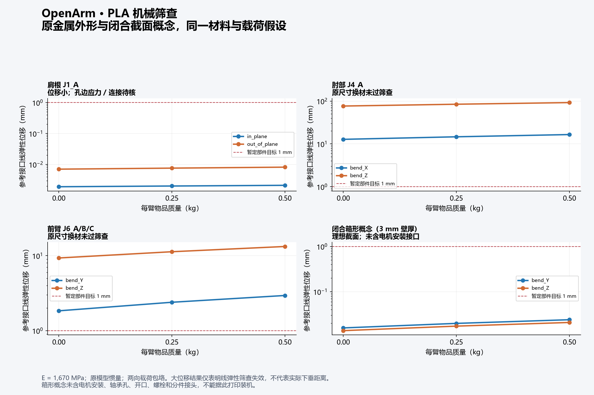
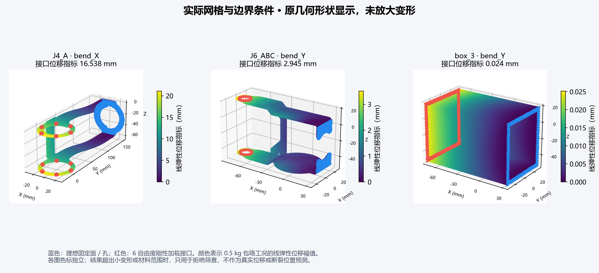

# OpenArm PLA 机械仿真筛查

2026-11-19 · 固定双臂上半身 · 不含下半身 · **已实际运行静态载荷提取与三维有限元求解**。

**结论：原金属薄板外形直接换成同尺寸 PLA，未通过本轮刚度筛查。PLA 闭合截面有明显改善空间，但整套 PLA 上半身尚未验证通过。** 这次结果是机械仿真，和此前离线模型推理分开记录。

检查了原 CAD 的肩根 J1_A、肘部 J4_A、前臂 J6_A/B/C；并对一个 J6 尺度的理想闭合箱形截面作对照。J4/J6 的失败足以拒绝“原尺寸直接换材”的当前候选，不需要等所有零件都算完才指出问题。**它不能否定经过重设计的 PLA 路线，也不能批准其余未测零件。**



## 实际计算结果

下表区间是两个指定载荷方向的结果，**不是统计置信区间**。位移是部件加载接口相对理想固定端的位移，不是整臂末端误差。空手仍承受下游电机、夹爪及原结构自重。

| 部件 | 空手接口位移指标 mm | 每臂 0.5 kg 接口位移指标 mm | 0.5 kg 两向最大转角 ° | 本轮判断 |
|---|---:|---:|---:|---|
| 肩根 J1_A | 0.002–0.007 | 0.002–0.008 | 0.248 | 位移小；孔边应力/真实连接待核，未批准 |
| 肘部 J4_A | 12.787–76.627 | 16.538–92.274 | 9.081 | 未通过 |
| 前臂 J6_A/B/C | 1.839–9.320 | 2.945–13.266 | 2.727 | 未通过 |
| 闭合箱形概念（3 mm 壁厚） | 0.014–0.016 | 0.021–0.024 | 0.014 | 仅此理想部件工况满足暂定数值门槛 |

J4 的大位移结果、以及超出材料强度范围的应力值，已经超出小变形线弹性模型的有效范围。**它们是刚度/强度筛查失败的信号，不是实际下垂距离、极限承载或断裂位置的预测。** 未运行几何非线性、塑性、断裂或失稳分析；尖角/理想约束附近的最大应力也没有作峰值收敛声明。原 J4/J6 的拒绝结论主要依赖明显不足的刚度，不依赖某个单点应力峰。

完整应力、转角、残差和各向量保存在 [汇总数据](summary.json) 与 [逐次求解结果](results/)。材料模量取 1,000 / 1,670 / 1,960 MPa 时，位移按线弹性关系反比缩放，已记录在汇总 JSON；这是同一模型的参数敏感性，**不是三种实物材料测量**。载荷加倍时线性结果也加倍，不能据此外推破坏过程。

J1_A 的接口位移小，但 0.5 kg 平面外包络的局部主拉应力峰约 23.9 MPa，超过暂定筛查值。其峰值及真实孔边承压、夹紧状态尚未独立验证，不能因位移小就把肩根标成通过。

## 箱形对照说明了什么

理想箱形截面长 108.5 mm，外宽 65 mm、外高 71.6 mm、均匀壁厚 3 mm，材料同为 PLA；两端的边界条件与载荷定义见下。其几何实心材料等效质量约 **111.4 g**，原 J6 薄板外形直接换 PLA 约 **18.6 g**（均未计紧固件）。

闭合截面对照只回答“把材料分配到封闭截面后，理想梁的刚度能否改善”。**它没有电机安装开口、轴承孔、螺栓孔、分件接缝和走线槽，也没有通过装配或运动干涉检查；不是可制造的 J6 改版，更不能直接切片装机。** 65 mm 外宽仍须与电机及周围零件核对，不能用额外外移肩轴来规避整个上半身的空间问题。

下一步应把真实电机/轴承接口和可装配开口放回 J6 闭合结构，再复算并做打印试件。当前证据支持继续这个方向，不支持整机批量打印。



## 材料、载荷和判据

材料对应已有订单所记 **Bambu PLA Matte**，不是拿 PLA Basic 代替。官方 [PLA Matte 技术数据表](https://store.bblcdn.com/s7/default/5b061f2feeac4ba88f355a33248bbda7/Bambu_PLA_Matte_Technical_Data_Sheet.pdf)列出 XY/Z 拉伸模量 1,960/1,670 MPa，Z 拉伸强度 22±4 MPa，密度 1.31 g/cm³；试样为 **100% 填充，并在 55°C 处理 8 小时后测试**。这些是厂商试样数据，不是本机、本批次或任意填充率打印件的保证。

本轮采用均匀各向同性 E=1,670 MPa，泊松比 0.35 为假定值；不包含打印层间、轮廓/填充路径、孔隙或温度相关本构。TDS 的热变形温度 52°C（1.8 MPa）不是机器人连续工作温度上限；热态与持载蠕变仍须实测。

在查看部件求解结果前保存了 [筛查契约](screening-contract.json)：0.5 kg 工况接口位移 ≤1 mm、转角 ≤0.5°、最大主拉应力 ≤6 MPa。6 MPa 来自 `(22−4)/3`，是**暂定工程筛查值，非统计保证值或认证许用应力**；这些部件门槛也不是由 VLA 成功率反推的精度要求。

载荷由固定版本原 MuJoCo 模型的质量/质心静态提取，保留原电机与原结构惯量；物品重心假设在 EE 局部 `[0,0,-0.1] m`。计算了垂下、水平、弯曲三姿态及 0 / 0.25 / 0.5 kg 三种物品质量，有限元使用水平姿态的力与弯矩**模长**，分别施加两个横向包络方向。

| 截面 | 空手力 N / 力矩 Nm | 0.5 kg 力 N / 力矩 Nm |
|---|---:|---:|
| 肩根 | 48.920 / 12.011 | 53.825 / 14.642 |
| 肘部 | 24.464 / 4.381 | 29.369 / 5.931 |
| 腕部/前臂远端 | 12.196 / 0.529 | 17.101 / 1.019 |

这是全三维力矩模长，与旧报告的右 J1 **轴向投影力矩** 11.70 / 14.33 Nm 含义不同。两者不应混成同一个量。

**载荷局限：** 未把每个新 PLA 零件的质量/惯量替换进整机；包络向量没有声称与 STEP 叶节点坐标完成精确装配姿态配准。部件内部电机/部件自重的分布载荷、真实路径及其他方向的扭转载荷没有完整建立。不能把“保留原惯量”和“理想刚性接口”的混合假定称为整机严格最坏情况。它是可重跑的候选筛查，不能输出额定负载。

## 边界条件与求解器验证

使用 Gmsh 4.15.2 对原 STEP 实体剖分直边四面体，在 scikit-fem 12.0.2 中使用**二次位移单元**解三维小应变弹性，单位 N/mm/MPa。加载接口使用 6 自由度刚性耦合，节点满足 `u = d + θ × r`；施加的合力/合矩与参考点严格配对。J6 三片按完全粘合处理，理想固定与刚性电机/轴承接口均偏向高刚度。

| 部件 | 固定边界 | 载荷接口及参考点（叶节点局部坐标，mm） |
|---|---|---|
| J1_A | 四个 R3.3 安装孔，X=±52.5、Z=±15 | R36 内圆柱面；`[0,56.5,0]` |
| J4_A | Y=154 的端面 | 半径 25 圆上的六个 R1.7 螺栓孔；`[0,0,-31.5]` |
| J6_A/B/C | X=33.5 的近端面；A/B/C 理想粘合 | X=-75、Y=0 的两个 R7.5 轴承孔；`[-75,0,-17.2]` |
| 箱形概念 | X=33.5 整个端面 | X=-75 整个端面；`[-75,0,-17.2]` |

加载方向、力矩符号、孔的角度及所有选择条件在 [求解脚本](fea.py) 中明确列出。J1 额外做平面内/平面外包络；未把肩桥或短躯干当成已建模。

独立标准梁校核：100×10×10 mm 梁、1 N 端力，Euler–Bernoulli 解析挠度 **0.239521 mm**，本求解器 **0.238498 mm**，差 **0.43%**（门槛 3%）。这一校核验证单位、刚性端口和弹性求解的基本行为，不验证 OpenArm 的实际连接模型。

| 部件 | 最细全局 h 上限 mm | 位移自由度 | 网格/CAD 体积差 | 两档网格全部工况最大位移变化 |
|---|---:|---:|---:|---:|
| 肩根 J1_A | 4.0 | 86,085 | 0.319% | 未做第二网格，不作收敛声明 |
| 肘部 J4_A | 2.8 | 243,693 | 0.005% | 0.07% |
| 前臂 J6_A/B/C | 2.8 | 268,461 | 0.127% | 0.10% |
| 闭合箱形概念（3 mm 壁厚） | 2.8 | 162,717 | 0.000% | 0.07% |

网格尺寸还受小特征和曲率约束，h 是全局上限。两档位移变化门槛 5%，体积差门槛 1%；通过表示**当前离散化敏感性检查**通过，不代表严格渐近收敛或峰值应力收敛。全部发布最终工况的自由残差 <1e-6、合力/合矩平衡相对误差 <1e-5；[汇总脚本](summarize.py)实际检查这些条件。

最初的分布面力版本允许电机/轴承加载界面局部翘曲，随后改为刚性接口；旧数据保存在 [探索性结果](exploratory/)，不与最终结果混用。内存压力导致两次并行作业中止，改为顺序运行，见 [完整尝试记录](attempts.json)。

## 运动筛查与尚未完成的验证

原刚体 MuJoCo 模型还采样了 121 组关节位置：从垂下向前伸，加入小幅肩/肘弯曲；关节值均在模型限位内，没有产生引擎报告的 >1 mm 穿透接触。此结果只对脚本中的路径、原碰撞几何和原碰撞过滤有效。**没有运行闭环控制、材料柔性、全工作空间搜索或新箱形结构的运动碰撞检查。**

未完成：带真实接口的 PLA 制造 CAD；J4_D/E、其他腕/夹爪接口、双臂肩桥、短躯干与桌面固定结构的完整 FEA；螺栓预紧/滑移、接触张开、轴承与电机外壳柔性；层间断裂、冲击、屈曲、热态、蠕变、疲劳与实物尺寸。左右镜像打印的层向和接头也必须重新确认。没有连接或驱动电机，没有打印或实测任何试件。

因此，“仿真跑完了就证明全部 PLA 没问题”的答案仍是 **不能这样判断**。本轮已排除原薄板形状直接换材；下一轮应验证带真实接口的 J6 闭合梁，再逐组扩展，最终用打印件载荷/温升/持载试验校准模型。

## 复现

所有几何来源于 OpenArm 2.0.0，硬件提交 `eefc9fa5509562e5e4d630db9a52027afdbc6af1`；完整原始 STEP SHA-256 为 `0f97a5fb308d5b09353aa67bbd32d7c08e55dc5629bcbe20c12f71c82ef13c94`。本目录仅含五个未经重设计的抽取实体，叶节点放置相同，不含整个上游仓库。几何与派生图保留上游 [CERN-OHL-S-2.0](../LICENSE-CERN-OHL-S-2.0.txt)，这是分析包，非制造发布。原始完整来源：[官方发布包](https://github.com/enactic/openarm_hardware/releases/tag/2.0.0)。

MuJoCo 本地源模型 SHA-256 为 `bdcebc15daa0fb91bbe87e1f6fb58fd4373e4819f0fe5930532211faefbbb027`，来源 checkout 提交 `a3c8a57ec15d385e3c1dbd3fd090ee486b7f258c`；记录本地哈希，不额外宣称其与该上游提交逐字节相同。提取出的载荷已随包保存，可不依赖 MuJoCo 重跑 FEA。

Python 3.12。先创建隔离环境，在本目录安装 [有限元依赖](requirements.txt)，顺序执行以降低内存峰值：

```powershell
python -m venv .venv
.venv/Scripts/python -m pip install -r requirements.txt
.venv/Scripts/python fea.py --part beam_check --geometry geometry --loads load-cases.json --out results/beam-rigid-h4.json --h 4 --fields
.venv/Scripts/python fea.py --part J6_ABC --geometry geometry --loads load-cases.json --out results/J6-rigid-h4.json --h 4 --fields
.venv/Scripts/python fea.py --part J6_ABC --geometry geometry --loads load-cases.json --out results/J6-rigid-h2.8.json --h 2.8 --fields
.venv/Scripts/python fea.py --part J4_A --geometry geometry --loads load-cases.json --out results/J4-rigid-h4.json --h 4 --fields
.venv/Scripts/python fea.py --part J4_A --geometry geometry --loads load-cases.json --out results/J4-rigid-h2.8.json --h 2.8 --fields
.venv/Scripts/python fea.py --part J1_A --geometry geometry --loads load-cases.json --out results/J1-rigid-h4.json --h 4 --fields
.venv/Scripts/python fea.py --part box_3 --geometry geometry --loads load-cases.json --out results/box-rigid-h4.json --h 4 --fields
.venv/Scripts/python fea.py --part box_3 --geometry geometry --loads load-cases.json --out results/box-rigid-h2.8.json --h 2.8 --fields
.venv/Scripts/python summarize.py --results results --out .
```

NPZ 场数据可由 `--fields` 重建，不提交所有大型中间网格。图中的二次位移仅在角节点取样，图示不代替积分点应力数据。复算载荷需另装 `mujoco==3.16.0`、`numpy==2.5.4`，运行 `load_cases.py --model <原模型文件> --out load-cases.json`。重新抽取 CAD 需 `build123d==0.13.0` 和对应 OCP，运行 `extract_structure.py --source <原完整STEP> --out geometry`。文件哈希与验证状态见 [checks.json](checks.json)。

方法来源：[Gmsh 官方文档](https://gmsh.info/doc/texinfo/gmsh.html)、[scikit-fem 官方弹性示例](https://scikit-fem.readthedocs.io/en/stable/listofexamples.html)。独立梁解析对照与全部部件结果均为本次本机实际计算，未引用他人的机器人实验成绩。
