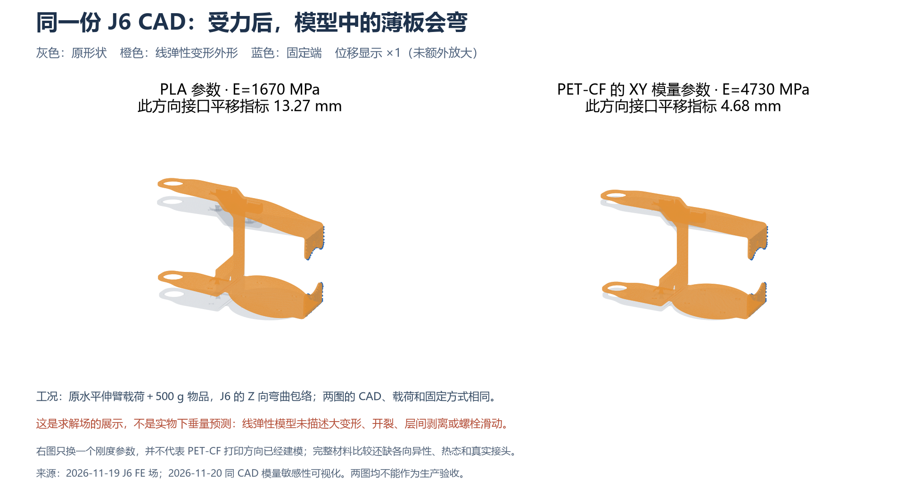

# 保持原 CAD 不变，只换材料：第一轮参数筛查

2026-11-20。用户当前要验证的是**原尺寸、原孔位、原厚度、原形状保持不变，换成另一种打印材料是否还能满足要求**。本报告不使用重设计的闭合箱梁作为回答，也不把其他小型机械臂的成功当作 OpenArm 换材证据。

## 之前的 PLA 测试究竟是什么

之前做的是三维线弹性有限元（FEA），不是实物测试，也不是一条机器人执行任务直到折断的动画：

1. 从官方 `OpenArm_2.0.STEP` 抽取 J1_A、J4_A、J6_A/B/C 的原始实体，保持形状不变。
2. 将选定安装边界固定，用刚性端口代表电机/轴承接口；J6 三片理想粘合。真实螺栓滑动、孔座接触尚未建模。
3. 从原刚体模型的水平伸臂姿态提取下游自重，并加入 0、0.25、0.5 kg 物品。对每个部件分别施加两个指定方向的力和弯矩包络；没有声称它们是精确装配配准后的全部工况。
4. 采用均匀 PLA 模型 E=1670 MPa、ν=0.35，计算加载接口移动多少、转动多少，以及各处应力。
5. 原先预设的暂定筛查线是：0.5 kg 工况接口平移 ≤1 mm、转角 ≤0.5°、PLA 主拉应力 ≤6 MPa。它们是工程初筛约定，**不是由 VLA 抓取精度反推的要求，也不是官方额定值**。

| 原形状部件 | 空手接口平移指标，mm | 0.5 kg 物品，mm | 之前能得出的结论 |
|---|---:|---:|---|
| J1_A 肩根 | 0.002–0.007 | 0.002–0.008 | 位移小，但孔边应力/连接未通过审核，不能批准 |
| J4_A 薄框架 | 12.787–76.627 | 16.538–92.274 | 刚度筛查失败 |
| J6_A/B/C 前臂薄板组合 | 1.839–9.320 | 2.945–13.266 | 刚度筛查失败 |

区间来自两个指定载荷方向，不是置信区间。**“不通过”的主要意思是：在这个模型中太容易弯，安装端发生过大位置变化。** 这可能破坏抓取位置和标定，但本轮没有测模型抓取成功率。大位移和超出材料强度的应力已超出小变形线弹性模型的物理适用范围，不能说实物必然下垂 92 mm，也没有求出哪一秒、哪一层先断裂。未模拟屈曲、断裂、热软化或长期蠕变。



图来自已有 J6 的有限元位移场，灰色原形状、橙色计算变形、蓝色固定端，位移显示倍数 1。右图按刚度参数缩放，不是新的正交各向异性 PET-CF 求解；这两张图均不是可依照制造的实物变形预测。[字段来源](same-cad-deformation-source.json)。

## 本次只换材料参数，算出了什么

保持相同几何、相同载荷、相同边界和 ν=0.35，只改变弹性模量 E。在这个线性模型中，`K ∝ E`，所以 `u(E) = u(1670) × 1670/E`。这是该简化 FE 模型的精确参数关系，不是经验猜测。

材料表给出的 XY/Z 模量分别作为不同的**均匀各向同性代理参数**。这不是实际打印方向的模型，不是上下界保证：缺少完整方向刚度/剪切参数、铺层/挤出路径、孔隙、接头及热态参数。先固定原载荷是为了分离刚度影响；没有重算全臂换料后的质量，因此也不是最终整机替材结果。

| 材料参数来源 | 本表 E，MPa | J4_A 指标，mm | J6_A/B/C 指标，mm | 仅就本表的平移筛查 |
|---|---:|---:|---:|---|
| PLA Matte，Z 参考 | 1670 | 92.274 | 13.266 | 超过 1 mm |
| PET-CF，XY 参考 | 4730 | 32.579 | 4.684 | 改善，但仍超过 1 mm |
| PAHT-CF，XY 参考 | 3860 | 39.922 | 5.739 | 改善，但仍超过 1 mm |
| 打印 316L，Z 参考 | 180000 | 0.856 | 0.123 | 这两项低于 1 mm；不等于制造/强度通过 |

表内均为 **0.5 kg 物品、两个指定方向中较大的加载接口平移**，不是夹爪末端误差。PET-CF/PAHT-CF 特意展示各自较高的 XY 模量参数，但即便这样仍没有通过这两件的指定筛查。另已计算 PLA XY、两种 CF 的 Z、316L XY，原始方向/空手/0.25/0.5 kg 结果全部保存在 [same-cad-materials.json](same-cad-materials.json)。**只能说这两种工程料的这轮参数筛查不支持直接替换；不能泛化为所有非金属打印材料都不行。**

J4_A 使用 E=4730 MPa、相同 h=2.8 网格参数另做了一次完整组装/分解/求解，6 个载荷工况与参数缩放作数值交叉核对。核对误差和运行时间由脚本写入 JSON；这一复算仍沿用相同简化材料假设，不增加物理模型的可信范围。J1/J6 及其余 E 点由既有解精确缩放，没有把每个参数点冒称为一次独立有限元重跑。

**强度没有因为换 E 就自动变好。** 在相同外力、相同几何、统一 E 和固定 ν 的线弹性模型里，应力场不会随 E 一起按比例下降。新材料需要各自的允许应力、层间失效准则和连接检查，不能把原先 PLA 的 6 MPa 门槛直接用来审批金属或其他聚合物。

## 金属打印与塑料打印要分别判断

打印 316L 的刚度参考明显高于上述聚合物，因此同形状更有希望达到位移目标；本表没有验证所有零件、原铝件换钢后的质量增长、电机负担、整机强度或关节配合。金属打印还需要供应商核薄壁、支撑、变形、公差、孔/螺纹与后加工。**CAD 形状可作为输入，不等于原文件直接打印后就可装机。** 本报告没有供应商制造审核，也没有证明金属打印是最低价工艺。

保持原 CAD 的下一层验证应补实际任务载荷、各材料重新计算的质量、真实接口和适当材料模型；逐件记成“已拒绝当前候选 / 仍待验证 / 在限定条件下通过”。改厚度、加筋或改箱梁属于另一个设计变量，应放在同形替材不满足需求之后单独比较。

## 来源与复现

- PLA：[Bambu PLA Matte TDS](https://store.bblcdn.com/s7/default/5b061f2feeac4ba88f355a33248bbda7/Bambu_PLA_Matte_Technical_Data_Sheet.pdf)，XY/Z 1960/1670 MPa。
- PET-CF：[Bambu TDS V3.0](https://store.bblcdn.eu/s8/default/df83cdd0401b4c169d7883a3e7bd2c8a/Bambu_PET-CF_Technical_Data_Sheet.pdf)，XY/Z 4730/2160 MPa。
- PAHT-CF：[Bambu TDS，文件名 V2、内容 V3.0](https://store.bblcdn.eu/s8/default/91dea87af3414d878a0696d2c51b98f7/Bambu_PAHT-CF_Technical_Data_Sheet_V2.pdf)，XY/Z 3860/2180 MPa。
- 打印 316L：[Toray Precision 参考数据](https://www.tpc.toray/en/technology/additive-print/add_material/add_material_001.html)，XY/Z 185/180 GPa；供应商参考值，不是本项目打印批次证明。

两种 CF 数据的试样为 100% 填充并经过规定的干燥/热处理；不能等同于任意 P1S 切片的打印件。打印方向、具体试样条件与其他局限见原 TDS 和 [原筛查报告](README.md)。本轮来源检索日期 2026-11-20，材料 PDF 没有复制进仓库。

在仓库根目录、原结构环境中运行：

```powershell
python design/material-review/structural-screen/fea.py --part J4_A --geometry design/material-review/structural-screen/geometry --loads design/material-review/structural-screen/load-cases.json --out design/material-review/structural-screen/results/J4-rigid-h2.8-E4730.json --h 2.8 --E 4730 --nu 0.35
python design/material-review/structural-screen/compare_same_cad.py
```

重新生成变形场与图（较大 NPZ 保持为本地生成物）：

```powershell
python design/material-review/structural-screen/fea.py --part J6_ABC --geometry design/material-review/structural-screen/geometry --loads design/material-review/structural-screen/load-cases.json --out work/same-cad-fields/J6-rigid-h2.8.json --h 2.8 --E 1670 --nu 0.35 --fields
python design/material-review/structural-screen/plot_same_cad_deformation.py --field work/same-cad-fields/J6_ABC-h2.8-bend_Z_0.5kg.npz
```

几何/载荷/基线/复算结果哈希写入 JSON。原 2026-11-19 结果保持不变；原理想箱梁不参与本次同 CAD 比较。
